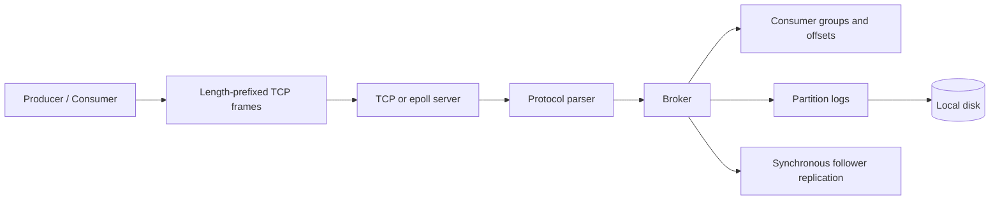

<div align="center">

# Kafka-Inspired Message Broker

**Persistent messaging, consumer coordination and event-driven networking in C++17.**

`C++17` · `TCP` · `Append-only logs` · `Linux epoll` · `CMake`

[Quick start](#quick-start) · [Architecture](#architecture) · [Client walkthrough](#client-walkthrough) · [Checks & benchmarks](#checks--benchmarks)

Maintained by [Kuvlay Naman](https://github.com/kuvlay)

</div>

---

A systems project that follows a message from a TCP connection to a durable partition log and back to a consumer. It implements a custom, length-prefixed protocol inspired by Kafka concepts. Apache Kafka clients cannot connect directly to this protocol.

## What is implemented

| Layer | Implementation |
| --- | --- |
| Storage | Append-only partition logs, CRC32 record validation, `fsync`, and startup recovery of incomplete or corrupt trailing records |
| Messaging | Produce and fetch operations, three partitions per topic, and standalone C++ clients |
| Consumer groups | Join, poll, commit and leave operations with deterministic partition assignment |
| Networking | Blocking thread-per-client server and nonblocking Linux `epoll` server using the same broker logic |
| Replication | Synchronous leader/follower writes, follower catch-up and manual promotion |
| Observability | Request and byte counters, latency percentiles, and committed concurrency benchmark results |

## Architecture



The networking layer reassembles complete frames before parsing commands. The broker coordinates topics and consumer groups, while partition records are persisted and restored during startup. Mutexes protect shared state.

[Detailed architecture](docs/architecture.md) · [Storage and recovery semantics](docs/storage_recovery_semantics.md)

## Quick start

**Requirements:** Linux or WSL, a C++17 compiler, CMake 3.16+, and Git. The current build includes Linux `epoll`; native macOS and Windows builds are not supported by this configuration.

```bash
git clone https://github.com/kuvlay/kafka-broker.git
cd kafka-broker
cmake -S . -B build
cmake --build build

# The sample clients are built separately from the CMake targets.
g++ -std=c++17 -Isrc clients/producer.cpp -o build/producer
g++ -std=c++17 -Isrc clients/consumer.cpp -o build/consumer

# Run one broker without a replication peer.
./build/kafka-broker 9092 data-local follower
```

The `follower` role accepts local produce/fetch requests and is used here for the single-process walkthrough. The clients connect to `127.0.0.1:9092`.

## Client walkthrough

Keep the broker running. In another terminal, from the repository root:

```bash
./build/producer orders 0 "hello broker"
./build/producer orders 1 "second partition"
./build/consumer orders group-a consumer-1
```

A successful producer request returns `OK`. The consumer joins its group, fetches available messages from assigned partitions, commits the next offsets, and leaves when there is no more data. It is a finite example client, not a continuously polling daemon.

The protocol supports `PRODUCE`, `FETCH`, `JOIN`, `GROUP_POLL`, `COMMIT` and `LEAVE`, with additional replication and metrics commands defined in [the parser](src/protocol.cpp). Requests must use the framing implemented by [BrokerClient](src/client.hpp); raw text over `netcat` is not a complete request.

### Compare server modes

Stop the current broker before reusing the same port:

```bash
./build/kafka-broker --epoll 9092 data-local follower
```

### Run a replication pair

Start these in separate terminals, follower first:

```bash
./build/kafka-broker 9093 data-follower follower
./build/kafka-broker 9092 data-leader leader 9093
```

Producer writes to the leader are synchronously forwarded to the configured follower. This illustrates replication mechanics; it does not implement a consensus protocol.

## Checks & benchmarks

Run the included checks directly after building:

```bash
./build/test_record
./build/test_topic_log
./build/test_protocol_parse
./build/test_broker_replicate
./build/test_stage11_metrics
```

| Evidence | What it covers |
| --- | --- |
| [C++ checks](tests/) | Record encoding, log storage, parsing, replication and metrics |
| [Recorded benchmark CSV](benchmark-results/tcp_vs_epoll_concurrency.csv) | 30 runs across TCP/epoll, 1–16 producers, 1,000 messages per producer, 1 KiB payloads and three repetitions |
| [Benchmark guide](docs/stage11_observability.md) | Workload configuration, collection and interpretation |

The committed benchmark results describe one workload on one machine. They are not production capacity guarantees. The commands above document available checks; no new execution result is claimed here.

## Code map

| Path | Responsibility |
| --- | --- |
| `src/broker.cpp` | Topic state, consumer groups and replication operations |
| `src/protocol.cpp` | Command parsing and validation |
| `src/tcp_server.cpp`, `src/epoll_server.cpp` | Connection handling and request dispatch |
| `clients/` | Producer, consumer and other command-line examples |
| `tests/`, `benchmarks/` | Correctness checks and workload drivers |
| `docs/` | Architecture, recovery semantics and implementation notes |

## Current scope

Consumer offsets live in memory and do not survive restarts. Topics have a fixed partition count, locking is coarse-grained, and replication has no quorum consensus, automatic leader election, automatic failover or background retry loop. No exactly-once delivery guarantee is claimed.

<details>
<summary>Project history and credits</summary>

Original development history and contributor attribution remain in Git. Existing notices are preserved; this documentation does not grant a new license.

</details>
